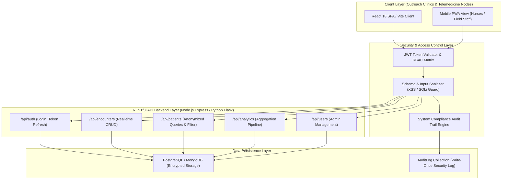

# HealthTech Patient Data Dashboard - System Architecture & Security Controls

## 1. High-Level Architecture Diagram

---

## 2. Tech Stack Justification

| Layer | Technology Choice | Engineering Justification |
| :--- | :--- | :--- |
| **Frontend Framework** | React 18 + Vite | Fast HMR build times, light memory footprint, component reusability, and instant client rendering for low-bandwidth rural connectivity. |
| **Data Visualization** | Recharts | SVG-based responsive charting library optimized for dynamic dashboard rendering and custom HSL color palettes. |
| **Backend API** | Node.js Express / Python Flask | Asynchronous non-blocking I/O ideal for handling concurrent real-time patient encounter logs from multiple outreach clinics. |
| **Database** | PostgreSQL / MongoDB | ACID compliant relational model or flexible document store supporting indexing on `patientId`, `dateOfVisit`, and `diagnosis`. |
| **Containerization** | Docker & Docker Compose | Standardized deployment environment across cloud VMs (AWS/GCP) and edge servers at local rural outreach centers. |

---

## 3. Data Protection & Security Controls

1. **Role-Based Access Control (RBAC)**:
   - **Doctor**: Read/Write access to Patient files, Encounter diagnostics, and aggregate Analytics.
   - **Nurse**: Fast data entry portal for new encounters, patient listing; restricted from modifying existing diagnostic history or system user management.
   - **Admin**: System user account provisioning, status disabling, audit log compliance review, and system analytics.

2. **Patient Data Anonymization**:
   - Zero Personally Identifiable Information (PII) such as full names, phone numbers, or government IDs are recorded in encounter records.
   - Patient entities use synthetic identifier keys (`P-2587`) paired with non-sensitive demographic buckets (`Age Group: 25-45`, `Gender: Female`).

3. **Authentication & Session Security**:
   - Session tokens are signed using JWT with SHA-256 signatures.
   - Automated token expiration triggers the **Session Expired Alert Modal**, locking the UI until re-authentication occurs.

4. **Compliance Audit Trail**:
   - Every state-mutating operation (`ENCOUNTER_CREATED`, `USER_ROLE_CHANGED`, `LOGIN_SUCCESS`) emits an immutable audit event recording timestamp, user identity, action, and IP address.
